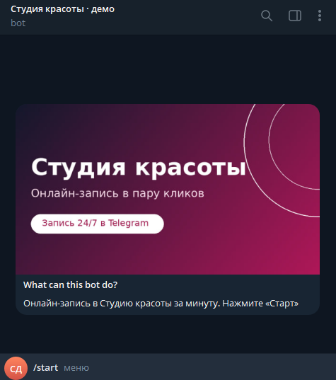
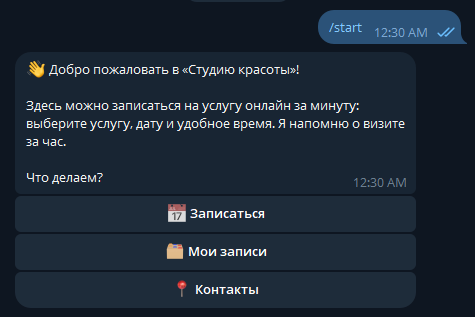
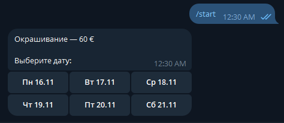
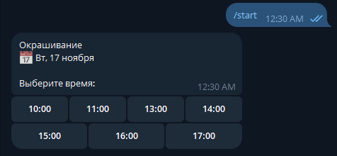

# Telegram-бот записи на услугу

Демо-бот для салонов, мастеров и репетиторов: клиент выбирает услугу, дату и время,
получает подтверждение и напоминание за час. Владелец видит новые записи и отмены.

## Запуск

1. Создайте бота у @BotFather и скопируйте токен.
2. `cp .env.demo` и впишите `BOT_TOKEN` и `ADMIN_ID` (свой ID можно узнать у @userinfobot).
3. `python -m venv .venv && source .venv/bin/activate`
4. `pip install -r requirements.txt`
5. `python bot.py`

## Настройка под клиента

В начале `bot.py`: список услуг и цен, рабочие часы, выходные дни, за сколько напоминать.

## Команды

- `/start` — меню
- `/my` — мои записи и отмена
- `/admin` — ближайшие записи (только владелец)

## Стек

Python, aiogram 3, SQLite (aiosqlite).

## Скриншоты

### 1. Telegram-бот

### 2. Приветствие

### 3. Процесс записи

### 4. Выбор даты

