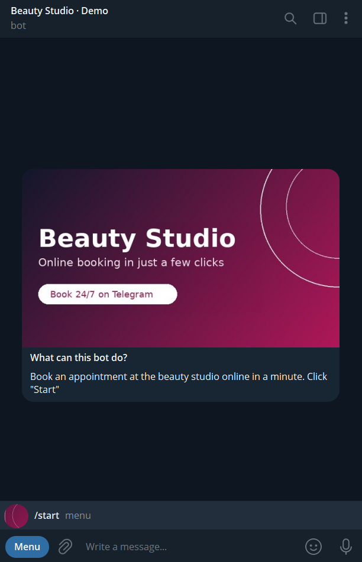
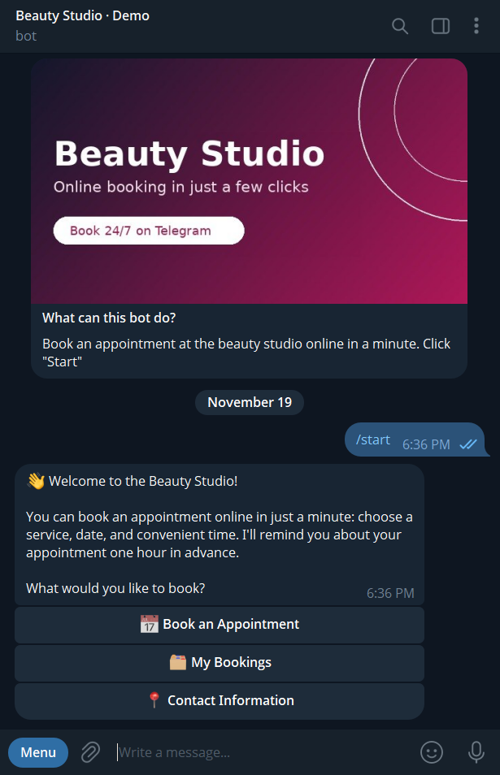
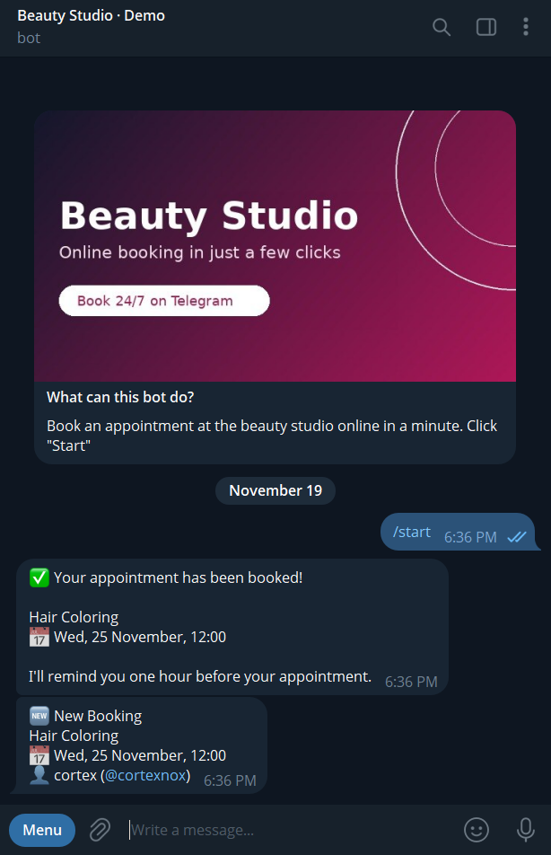
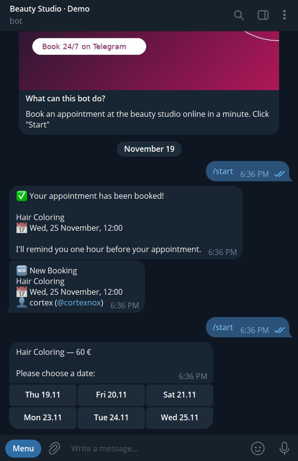

# Telegram Appointment Booking Bot

A demo bot for beauty salons, service professionals, and tutors. Clients choose a service, date, and time, receive a booking confirmation and a reminder one hour before their appointment. The owner receives notifications about new bookings and cancellations.

## Getting Started

1. Create a bot using [@BotFather](https://t.me/BotFather) and copy its token.
2. Run `cp .env.demo .env` and enter your `BOT_TOKEN` and `ADMIN_ID` (you can find your Telegram ID using [@userinfobot](https://t.me/userinfobot)). On Windows, use: `copy .env.demo .env`.
3. `python -m venv .venv && source .venv/bin/activate`
4. `pip install -r requirements.txt`
5. `python bot.py`

## Client-Specific Settings

At the beginning of `bot.py`, you can configure the list of services and prices, working hours, days off, and how far in advance reminders should be sent.

## Commands

- `/start` — open the main menu
- `/my` — view and cancel your appointments
- `/admin` — view upcoming appointments (owner only)

## Tech Stack

Python, aiogram 3, SQLite (aiosqlite).

## Screenshots

### 1. Telegram Bot

### 2. Welcome Message

### 3. Booking Process

### 4. Date Selection

